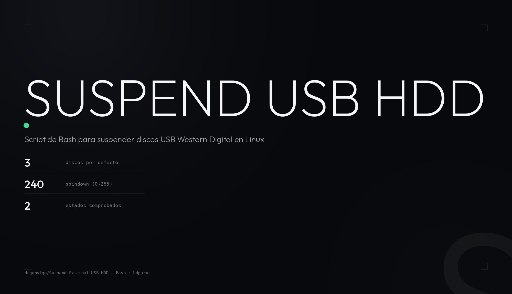

<meta property="og:title" content="SUSPEND EXTERNAL USB HDD">
<meta property="og:description" content="Un script de Bash para suspender los discos USB que no se apagan solos.">
<meta property="og:image" content="https://raw.githubusercontent.com/Hugopvigo/Suspend_External_USB_HDD/main/docs/capturas/og.png">

<p align="center">
  
</p>

<p align="center">
  <b>Un script de Bash para suspender los discos USB que no se apagan solos.</b><br>
  Fija el tiempo de spindown con hdparm y fuerza la suspensión cuando el disco sigue despierto.
</p>

<p align="center">
  
  
  
  
</p>

---

## Qué es esto

Algunos discos duros externos de Western Digital no entran en suspensión
automáticamente en Linux: siguen despiertos, haciendo ruido y gastando.
`suspend_disk.sh` los pone en standby a mano.

- Fija el tiempo de spindown de cada disco con `hdparm -S`.
- Pregunta el estado real con `smartctl -n standby`.
- Solo suspende los que están activos; los que ya están en `STANDBY` no se tocan.

El script **no detecta discos**: trabaja sobre una lista fija de dispositivos
(`/dev/sda`, `/dev/sdb`, …) que tienes que poner tú. Tampoco filtra por marca
ni por bus USB.

## Requisitos

- Linux
- `smartmontools` (para `smartctl`)
- `hdparm`
- Permisos de root

```bash
sudo apt install smartmontools hdparm
```

## Cómo se usa

```bash
git clone https://github.com/Hugopvigo/Suspend_External_USB_HDD.git
cd Suspend_External_USB_HDD
chmod +x suspend_disk.sh
sudo ./suspend_disk.sh
```

Antes de la primera ejecución, ajusta al principio del script la lista de
discos y el tiempo de spindown:

```bash
SPINDOWN_TIME=240                     # valor que se pasa a hdparm -S
DISKS=("/dev/sda" "/dev/sdb" "/dev/sdc")
```

`SPINDOWN_TIME` se pasa tal cual a `hdparm -S`, que lo interpreta según el
disco (normalmente minutos, de 1 a 255). Valores habituales: 60, 120 o 240.

Para ver el estado de un disco antes de tocar nada:

```bash
sudo smartctl -n standby /dev/sda
```

## Automatizar con cron

En el repositorio hay un ejemplo de tarea programada en
[`crontab`](crontab):

```cron
*/50 * * * * /home/hugo/suspend_disks.sh >> /home/hugo/suspend_disks.log 2>&1
```

Adapta las rutas a tu usuario (el ejemplo apunta a `/home/hugo/`) y al nombre
real del script, que en el repositorio es `suspend_disk.sh`, en singular.
Instálalo con `crontab crontab` o pegando la línea en `crontab -e`. Cada 50
minutos es más que suficiente: el script solo actúa sobre los discos que estén
despiertos.

## Cómo funciona

1. Recorre la lista de discos y, en cada dispositivo de bloque que exista,
   ejecuta `hdparm -S $SPINDOWN_TIME` para fijar el tiempo de spindown. Si el
   disco no lo acepta, avisa y sigue.
2. Vuelve a recorrer la lista y pregunta el estado con `smartctl -n standby`.
3. Decide según el estado:

   | Estado | Acción |
   |---|---|
   | `STANDBY` | No hace nada: ya está suspendido. |
   | `ACTIVE`, `IDLE`, `IDLE_A`, `mode` | Ejecuta `hdparm -y` para suspenderlo. |
   | Cualquier otro | Avisa: estado no identificado o no soportado. |

4. Los dispositivos que no existen o no son bloques válidos se saltan.

El resultado se imprime por pantalla; para tener un log, redirige la salida
(como hace el ejemplo de cron).

## Estructura

```
Suspend_External_USB_HDD/
├── suspend_disk.sh   script principal
├── crontab           ejemplo de tarea programada
├── docs/capturas/    cabecera del README
└── LICENSE           CC BY-NC-SA 4.0
```

## Un detalle sobre el log

El script define `LOG_FILE=/var/log/suspend_disks.log` al principio, pero no
lo usa en ningún momento: **no escribe ningún log**. La salida va a la
consola, o al fichero al que redirijas. Si quieres el log en `/var/log`,
redirige tú la salida.

## Licencia

**CC BY-NC-SA 4.0** — se puede compartir y adaptar con atribución, siempre sin
uso comercial y bajo la misma licencia. Texto completo en
[LICENSE](LICENSE).

---

<div align="center">
  Hugo Pérez Vigo · [@hugopvigo](https://x.com/hugopvigo) ·
  [github.com/Hugopvigo](https://github.com/Hugopvigo)
</div>
